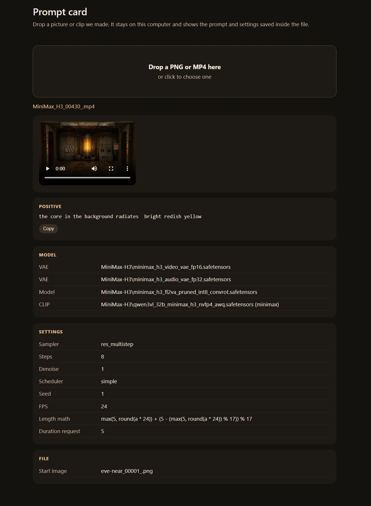
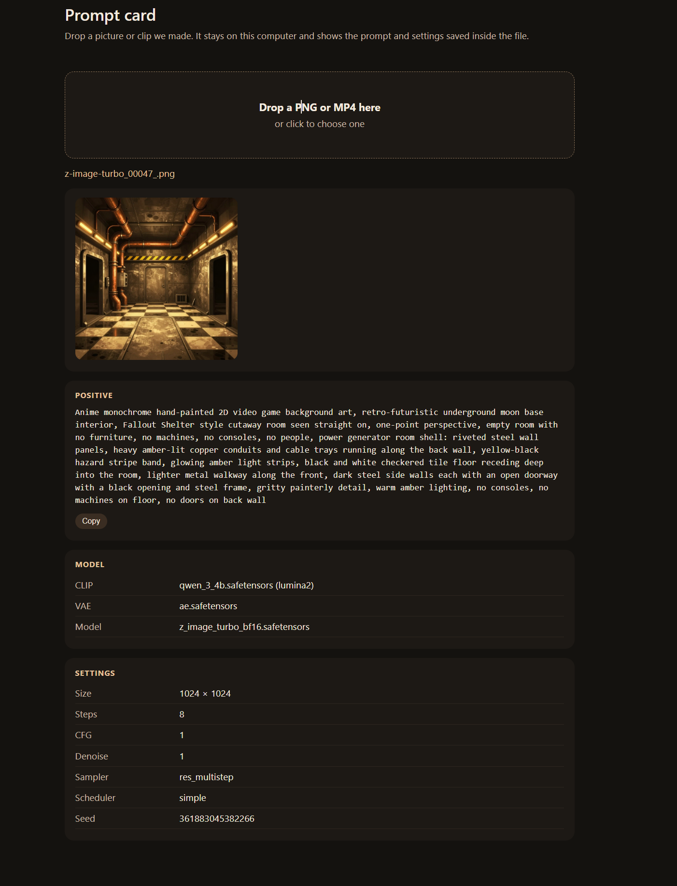
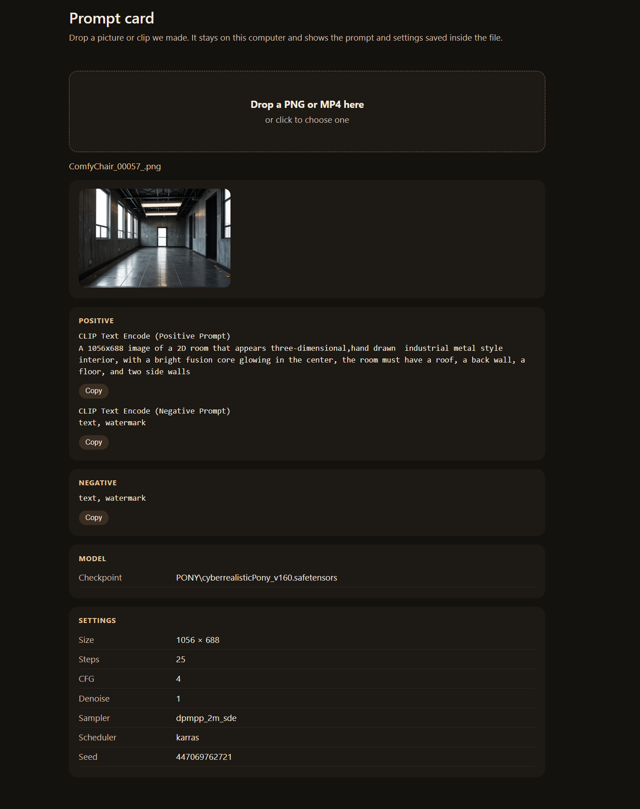

# Prompt card

One page. Drop a Comfy PNG or MP4 on it. The prompt, model, and settings are read in the browser from the file itself. Nothing is uploaded.

A file only shows a prompt when Comfy saved the graph. A Grok clip, a joined clip, or a silent copy comes up empty.

Open `index.html`, or the GitHub Pages link for this repo.

## Examples

A MiniMax clip, a Z-Image still, and a Pony still. The prompt stays in the browser.

